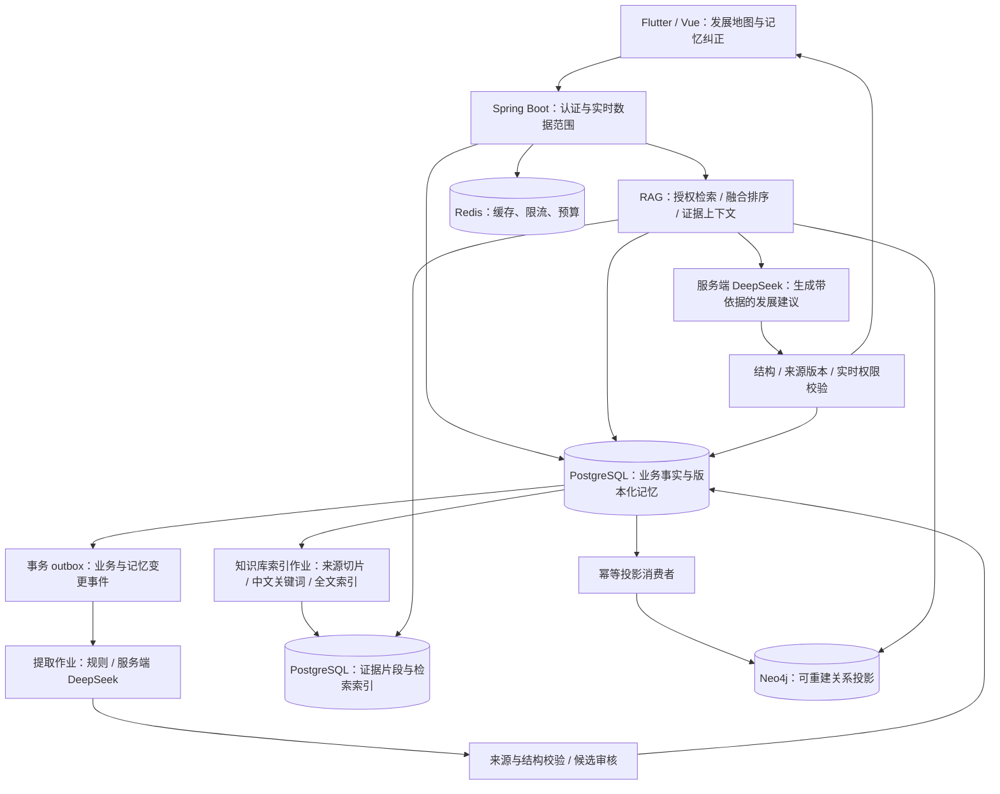

# AI 地图长期记忆技术方案

日期：2026-10-09  
状态：本地实现与隔离验收完成，尚未生产上线。关联变更归档于 `openspec/changes/archive/2026-10-09-ai-map-long-term-memory/`。数据库按用户要求同容器运行。

已落地范围与验证证据以归档任务、`docs/ai-map-validation.md` 和运行中的 `/api/openapi` 为准。方案中的页面示意和后续扩展不能替代现行 OpenAPI 契约。

## 1. 功能定位与范围

AI 地图页面只提供一个核心功能：**持续记住我和公司做过什么，结合目标与成果，分析下一步发展方向。** 页面名称继续使用“AI 地图”，内容标题为“成长与发展地图”。

“越用越好用”来自持续积累可靠记忆、检索相关经历、接受用户纠正和记录实际成果。建立个人与公司记忆知识库，首期通过文本 RAG（检索增强生成）与受限图谱检索实现，不以调用 DeepSeek 接口作为模型自动训练，不实现模型微调。

个人分析回答：我做过什么、形成了哪些有证据的经验、距离本人目标还缺什么、下一步可以怎样验证。组织分析回答：公司或授权团队做过什么、沉淀了哪些能力、哪些业务方向值得验证、还缺哪些信息。

### 1.1 本期页面边界

- 只有一个发展分析主页面，“个人 / 组织”是数据范围切换，不是两个独立功能。
- 移除“发展分析 / 堵点风险 / 行动规划”三个入口，移除独立风险雷达、演示行动清单及完成进度。
- 建议展示在发展结论中；查看依据、纠正记忆、填写目标属于该功能的辅助交互。
- 首期不在 AI 地图中派发任务，也不新增通用聊天工作台、日周月筛选或自动执行功能。
- 数据记录继续复用日志、任务反馈和已生效业务记录；不要求用户每天重复填写一套成长档案。
- 公司方向为基于证据与假设的建议，不承诺预测营收、晋升日期或成功概率。

### 1.2 与既有方案的关系

本方案对应根目录 `方案.md` 第 7 节。Flutter 与 Web 页面、后端及统一数据容器已在本地实现并验证；中文检索、四组效果比较和恢复演练见 `docs/ai-map-validation.md`。生产域名、HTTPS 和正式管理员仍需在部署环境验收。其他业务沿用基线方案。

导航遵从 `AGENTS.md`：从左到右为导图、视图、日志、AI地图、我的，默认导图。旧文档中相反的导航描述不作为本次设计依据。

## 2. 页面设计

### 2.1 Android 主页面

```text
AI 地图                              管理记忆
成长与发展地图

[个人] [组织：本团队 / 本部门 / 全公司]  ← 仅显示已授权范围
目标：希望提升技术方案设计能力          [编辑目标]
记忆更新至：……   分析生成于：……

发展概览
“你已有接口交付与问题排查经验，可以尝试独立设计小型模块。”
依据充分程度：有限；缺少独立方案与验收记录

经历与成果 → 有证据的经验 → 本人目标 → 待补环节 → 下一步建议
                    [点击节点查看依据]

下一步建议
实践：独立设计一个边界明确的小模块
验证方式：方案评审、交付结果、复盘反馈
前提与缺失信息：需要确认可投入时间和实际项目机会

[更新分析]   [这条建议不合适]
```

Android 默认以纵向路径卡片展示，避免一屏绘制大量节点；节点展开显示来源及关联关系。Web 使用同一数据契约，可用 Vue Flow 展示关系图，右侧抽屉查看证据。布局不同，分析结果、权限、状态与纠正行为相同。

“管理记忆”打开抽屉或底部面板，支持查看、补充、纠正、删除、停止记忆某个来源。第一期不提供对下属私人目标与偏好的穿透入口。

### 2.2 页面状态

| 状态 | 页面行为 |
|---|---|
| 无经历记录 | 引导提交日志或补充一条本人经历，不生成样例结论 |
| 无目标 | 可展示经历概览，邀请本人设置目标，不替本人指定职业方向 |
| 证据不足 | 说明已有事实、缺失信息和建议验证方式，不做能力定论 |
| 记忆待确认 | 显示候选观察，允许纠正，不作为确定能力展示 |
| 知识库索引更新中 | 显示入库与索引状态；新记录可授权直读，失效旧片段不参与分析 |
| RAG 未命中相关证据 | 说明本次检索范围与信息缺口，引导补充成果，不强行给出结论 |
| 更新中 | 保留仍授权且来源有效的旧分析，显示其日期及待更新状态 |
| DeepSeek 未配置/失败 | 可查看已存记忆与有效历史结果，生成按钮提示不可用并支持重试 |
| 图谱不可用 | 降级到授权文本证据检索，标记缺少关系路径；基本业务不受影响 |
| 来源失效或失权 | 隐藏依赖该来源的结论并重建结果，不能继续展示失权旧分析 |

## 3. 记忆的内容与边界

### 3.1 四类记忆

| 类别 | 个人 | 组织 |
|---|---|---|
| 经历与成果 | 项目、参与角色、交付物、反馈、验收记录 | 客户需求、业务项目、交付成果、可复用资产 |
| 目标与方向 | 本人确认的成长目标和职业意愿 | 审核生效的公司目标或授权范围目标 |
| 偏好与约束 | 本人填写的建议偏好、可投入时间 | 已确认的预算、资源、合作约束 |
| 经验与复盘 | 本人复盘、可追溯的实践反馈 | 项目复盘、成功方法、失败原因及适用条件 |

正式项目成果可以按业务授权进入组织记忆；个人职业意愿和建议偏好仅本人可见，不因管理员或上级角色自动开放。私人备注、未提交日志草稿、密码、手机号和密钥不参与记忆提取。员工不会因参与项目自动获得组织分析权限。

### 3.2 确定性分层

- `FACT`：来源明确的业务事实或本人陈述。本人写“我完成了联调”只代表自述事实，不自动等于正式验收。
- `OBSERVATION`：从事实中提取的候选观察，如“积累了接口协作经验”，标明待验证；可被纠正。
- `HYPOTHESIS`：发展分析中的推测，如“可尝试技术负责人方向”，依赖明确目标、条件和证据。

上述分类和记忆状态分开：确认一条观察不将其自动转换为客观事实。系统生成的建议不会自动进入事实层，也不会因为多次生成而提高证据权重。生成式摘要只作检索导航，事实仍由原始来源支撑。

“参与过”“独立完成过”“通过验收”分别建模；重复提到同一成果只计一个事件，防止日报字数或重复记录变成能力评分。

### 3.3 个人与公司记忆知识库

知识库是现有存储上的逻辑能力，不要求增加第三套数据库或独立知识库页面。按个人与组织分域保存以下三层内容：

| 层次 | 内容与用途 |
|---|---|
| 原始资料层 | 业务系统中合法保留的已生效日志、任务事件、成果、目标与复盘，作为来源权威记录 |
| 精选记忆层 | 规则和 AI 从原始资料提取的经历、成果、经验及候选观察，带来源、版本、类型与确认状态 |
| 检索索引层 | 来源证据片段、关键词/全文索引、受限图关系，以及后续可选向量索引；均可由前两层重建 |

原始资料保留遵循业务策略，不表示全部内容都已获准进入 AI 知识库。未被 AI 选中的资料保留在原业务系统，可在允许范围内重新提取；未选中、被拒绝或被排除的正文不得绕过入库规则直接检索给模型。有效精选记忆引用的必要原文证据可以切片检索；候选观察默认只用于管理与确认，不参与正常发展分析。

知识库不是公司信息默认公开的入口。员工仅使用本人的发展记忆；组织知识库沿用团队、部门、全公司权限。私人目标与偏好保持本人独立权限，不进入公司记忆。

### 3.4 AI 筛选与入库规则

AI 输出入库候选及 `selectionReason`、来源 ID、证据位置、确定性类别、建议关系。服务端使用确定性规则决定允许范围、验证来源、去重和执行入库；用户确认或正式审核决定需要人为判断的内容。

| 内容 | 入库策略 |
|---|---|
| 正式任务角色、验收事件等结构化事实 | 规则验证有效来源后自动形成 ACTIVE 记忆 |
| 日志中可定位的经历与成果自述 | AI 提取后校验原文、来源与版本，符合预设低风险规则才自动入库，明确标注自述 |
| “擅长沟通”等能力观察或发展判断 | CANDIDATE，等待本人或组织范围内授权人员确认；仍保留观察或推测类别 |
| 公司战略、正式组织经验等关键陈述 | 走现有独立审核，审核通过后进入有效记忆 |
| 无来源、无关、重复、敏感或已排除内容 | 不进入有效知识库；保留必要处理状态与原因，不在普通日志复制正文 |

自动入库规则和提取器有版本、回滚及抽样评估。AI 不能直接写知识库、提升权限、确认自己的推断或删除原始业务资料。建议、分析结果、点赞和摘要不自动作为新事实入库，避免系统反复引用自身输出。

## 4. 总体技术架构



### 4.1 各组件职责

| 组件 | 责任 |
|---|---|
| PostgreSQL | 权威业务数据、精选记忆与版本、来源证据片段、关键词/全文索引、删除标记、分析结果、作业与审计 |
| Neo4j | 保存 `Memory` 节点和 `EVIDENCE` 关系的可重建投影，返回受限记忆证据路径；可由 PostgreSQL 重建 |
| DeepSeek | 候选记忆提取、候选关系提取、解释与建议生成；没有数据库凭据和执行权限 |
| Spring Boot | 入库决策与权限过滤、RAG 检索与融合排序、上下文组装、输出校验、版本冲突和审批 |
| Redis | 缓存、速率限制、预算预留；不作为长期记忆唯一存储 |

Neo4j 不直接预测未来。图路径说明关联与依赖，不证明因果；缺少经营数据时只能分析投入主题与能力，不输出经营预测。

RAG 不要求必须有向量数据库。首期采用 PostgreSQL 中文关键词匹配和全文检索、业务标签、Neo4j 有限路径检索。默认全文分词不能保证中文效果，实施时用中文查询集评估，必要时应用层分词并以关键词匹配补充。

后续语义检索可使用 PostgreSQL 的 pgvector 扩展，避免新增独立向量数据库。启用前核实部署兼容性、中文嵌入模型和数据处理范围；配置模型版本与向量维度，升级时重建索引，不能混用不同模型或维度的向量。DeepSeek 对话服务只负责提取与生成，不假定它提供嵌入接口。

## 5. PostgreSQL 数据设计

复用业务表、`outbox_events`、审核表和审计表；实际表定义以已执行的 `V4__memory_knowledge.sql`、`V5__knowledge_rebuild.sql` 为准，不修改已执行迁移。

| 表 | 主要字段与用途 |
|---|---|
| `memory_items` | id、company_id、domain、owner_id、scope_type、scope_id、category、claim_type、status、version、content、source_type、source_id、source_version、locator、provenance；记忆当前状态和来源 |
| `memory_versions` | company_id、memory_id、version、content、claim_type、provenance、status；保留修订正文和状态 |
| `memory_sources` | company_id、memory_id、memory_version、source_type、source_id、source_version、evidence_locator；绑定原始证据位置 |
| `memory_relations` | id、company_id、from_id、to_id、relation_type、status、version；权威关系，附证据绑定，不依赖 Neo4j 唯一保存 |
| `memory_preferences` | company_id、owner_id、explicit_goals、response_preferences、version；私人目标与偏好，允许字段关闭 |
| `memory_exclusions` | company_id、actor_id、domain、scope_id、source_type、source_id；防止删除后被历史回填重新提取 |
| `memory_feedback` | id、company_id、analysis_id、item_key、actor_id、type、comment、request_key；记录反馈，不把“喜欢”当成事实确认 |
| `development_analyses` | id、company_id、owner_id、domain、scope_type、scope_id、state、memory_revision、permission_fingerprint、input_manifest、output、prompt_version、created_at；保存结果与证据快照 |
| `memory_projection_state` | company_id、projected_revision、state、last_error、updated_at；按公司记录图投影状态 |
| `knowledge_chunks` | id、company_id、memory_id、memory_version、source_type、source_id、source_version、locator、chunk_text、content_hash、chunker_version、search_text、index_state；域和范围通过当前记忆再校验 |
| `knowledge_index_jobs`、`knowledge_rebuild_jobs`、`knowledge_index_state` | 增量索引、按公司分页回填和版本切换；入库状态与索引状态独立 |
| `rag_retrieval_runs` | company_id、analysis_id、memory_revision、index_revision、retriever_version、selected_chunk_ids、source_manifest、degraded_reason；检索审计与分析可复现清单 |

`memory_relation_sources` 保存关系与证据的多对多绑定；记忆版本、来源、关系、分析引用使用 company_id 组合约束，拒绝跨公司外键。`memory_forget_jobs`、`memory_model_calls` 和 `memory_extraction_jobs` 分别记录清理、用量与提取状态。

`domain=PERSONAL` 必须指定本人 owner_id；组织记忆必须指定公司、部门或团队范围。状态为 `CANDIDATE / ACTIVE / DISPUTED / SUPERSEDED / INVALIDATED / DELETED`。用户纠正产生新版本，旧版本保留历史身份但不参加当前检索。

历史重复提取使用 `(company_id, source_type, source_id, source_version)` 作业键；记忆再以公司、域、范围、来源版本及定位位置约束去重。同一成果以原始事件 ID 去重，不自动合并不同人员或不同项目。

证据片段以公司、记忆域、来源版本、证据位置及切片器版本建立幂等键，正文哈希仅用于同权限边界内去重。片段必须绑定当前有效记忆与原始来源，重用片段时仍校验全部来源。业务记忆状态与 `index_state=PENDING/READY/FAILED/INVALIDATED/DELETED` 独立，入库成功不等于索引已准备好。

关键词/全文字段存于 `knowledge_chunks`，使用 GIN 索引或等效方案。可选 `knowledge_embeddings` 表引用片段并保存 embedding_model、embedding_version、dimension、向量与索引状态；未启用语义检索时不部署该扩展。检索审计默认保存 ID、配置版本和分值，不复制完整上下文正文；遗忘时按依赖清理。

## 6. Neo4j 图模型

### 6.1 节点与关系

当前图模型只有 `Memory` 节点与 `EVIDENCE` 关系。节点按公司和记忆 ID 标识，携带域、范围、所有者、类别、状态和版本；边按关系 ID 标识，携带状态和版本。关系业务类型与证据绑定仍保存在 PostgreSQL。图路径仅用于补证，不把一次经历等同于熟练能力或确定战略。投影由服务端按公司周期性从 PostgreSQL 全量刷新；当前是单实例部署。

首期图内保存受限标签、ID 与关系，详细正文仍从 PostgreSQL 授权读取；连标签也视为受保护信息。使用 Java Driver、参数化查询与应用层白名单模板，不允许用户或模型生成任意 Cypher 执行。

### 6.2 检索规则

1. Spring Boot 从会话确定公司、本人、允许的组织范围和当前权限版本，不信任客户端提交范围。
2. 在 PostgreSQL 获取允许使用且来源仍有效的记忆与关系 ID；私人、待确认和失效内容按用途过滤。
3. Neo4j 使用授权 ID 集合进行受限遍历，检查每个中间节点、边和来源，不仅检查终点。禁止借无权节点计算计数、推荐理由或路径。
4. 当前图查询最多 3 跳、20 条返回路径，并设置 3 秒事务超时；候选 ID 先从授权记忆集合取得，超大范围先按主题与目标缩小。
5. 回到 PostgreSQL 校验版本与证据，读取必要正文再组装模型输入。最终输出再次检查来源。

## 7. 记忆写入与更新流程

### 7.1 自动积累

1. 日志提交、修订审核生效、任务反馈、验收和重点变更，与业务写入在同一事务产生 outbox 事件。
2. 消费者按来源与版本去重；读取生效且允许记忆的内容。未审核候选版本不进入有效记忆。
3. 规则直接提取结构化事实；DeepSeek 仅处理必要文本，输出经历、成果、观察、候选关系及证据位置。
4. 校验来源是否存在、版本是否有效、证据位置是否属于输入。AI 推断即使来源合法，也不自动变成事实。
5. 结构化业务事实进入 `ACTIVE`；AI 候选观察进入 `CANDIDATE`。仅使用明确自述、低风险且证据可定位的候选经历生成带自述标记的记录，能力判断仍待验证。
6. 同一事务保存记忆、关系和投影事件；独立消费者同步 Neo4j。异步最终一致，不做 PostgreSQL 与 Neo4j 双写事务。

7. 有效记忆变更同时驱动知识库索引作业，建立必要证据片段和关键词/全文索引；候选观察不进入正常 RAG 索引。索引作业失败不回滚已提交的日志，可独立重试。

已有历史资料使用分页回填作业，遵循相同排除、版本与去重规则；可以暂停和续跑。图谱投影只接受更高版本，删除墓碑优先，乱序旧事件不能恢复已删除节点。

### 7.1.1 来源切片与索引

- 按日志字段、任务事件、成果说明和复盘段落切分；短记录整体保留，长记录保持适量上下文。初始建议每片段约 300～600 中文字符、重叠不超过 80 字符，最终按引用完整性评估调整；字符数不等于模型 token。
- 不跨公司、个人/组织域、权限范围、来源版本或确定性类别合并片段。来源需标题、业务时间、记录角色、记忆 ID、原始 ID/版本和定位信息。
- 只对允许入库的内容和其必要证据索引；字段白名单、敏感过滤、来源排除在切片前执行。候选、争议、失效和删除状态不能因为旧索引仍存在而被检索。
- 切片版本升级执行可暂停的重建；新索引复核后原子切换读取版本，旧索引不用于新分析。图、文本索引的版本单独记录，投影滞后时仍以权威来源版本控制。
- 索引待就绪时，可对少量当前授权记忆直接读取原文完成降级；不能回退到失效旧版本。超过直读预算则提示索引更新中。

### 7.2 人工补充与纠正

- 本人可以补充经历与目标、纠正自己的候选观察或隐藏记忆；记忆纠正不修改原日报。
- 正式业务事实有误时，继续进入原业务修订审批；争议期间该记忆标记 `DISPUTED`，分析展示争议或跳过，不覆盖正式记录。
- 公司目标、正式组织经验等关键内容的新增或修订走现有候选版本、独立审核及版本校验；旧生效版本在审核期间保持有效。
- 从系统事件生成的事实索引只是原事实的投影，不新增一轮业务审批；AI 组织观察及关系需指定范围内人员确认，重要战略陈述走正式审核。
- 确认与修订操作携带 version，版本过期返回 409；禁止用记忆入口绕过业务审核和自审规则。

### 7.3 失效、删除与遗忘

- 来源修订、撤回、授权缩小或账号停用，先阻止关联记忆被检索、发送给模型与展示，再异步清理投影和缓存。
- 删除个人记忆时写入排除规则，防止原始日志在下次回填中重新生成该记忆；“恢复记忆”必须本人显式操作。
- 个人隐藏只影响本人分析，不能删除公司合法保留的正式业务成果；界面解释实际作用范围。
- 图节点、关系、知识库切片、关键词/全文索引、可选向量、派生摘要、缓存、检索快照、分析输入快照和已生成输出都按依赖失效。失权分析整份隐藏后重建，不能只移除来源链接而保留泄露的正文。后台重建与乱序索引事件也必须检查排除规则和来源有效版本。
- 遗忘操作另有 `PENDING / SUCCEEDED / FAILED` 清理作业状态；完成前提示“已停止使用，正在清理”。模型正在生成时也要取消或阻止旧输出提交。
- 业务审计按公司保留策略保存必要操作者、对象和时间，不在审计中重复存储已遗忘正文。备份按保留期限到期；恢复备份后须重放删除与排除记录才能开放检索。
- 无法撤回已经发给模型服务商的数据；因此事前最小化输入，供应商留存条件在部署前核实，不承诺删除 API 能消除全部外部副本。

## 8. RAG 发展分析与个性化

### 8.1 分析步骤

1. 读取当前有效且授权的记忆，以及本人明确填写的目标和偏好。
2. 将当前目标与分析范围构造成检索查询，执行第 8.1.1 节文本 RAG 与受限图谱检索；优先保留重要旧成果，不因记录较旧自动认定能力消失。系统生成查询不新增聊天入口。
3. 用规则合并同一事件并标明“自述 / 参与 / 独立负责 / 验收”；不以记录数量直接计算人才评分。
4. 组装有限上下文：目标、相关经历、原文证据片段、证据路径、已确认约束、相关纠正、缺失信息。记录本次使用的片段 ID、来源版本、索引及检索器版本清单。
5. DeepSeek 输出事实概览、候选方向、条件、信息缺口和最多三条实践建议。
6. 服务端验证 JSON 结构、引用 ID、权限与版本；未知来源或无依据的事实返回失败，不直接展示原始输出。
7. 生成结束时复查权限和记忆修订号。若变化则结果失效并重新排队；读取历史分析与 SSE 最终结果时同样检查。

首期使用 `basisQuality=SUFFICIENT/LIMITED/INSUFFICIENT` 表示依据充分程度，依据来源覆盖、是否有成果验证和冲突情况规则计算，并展示原因。它不是成功概率，也不是统计置信度。

### 8.1.1 文本 RAG 与受限图谱检索

1. **授权与查询构造**：从会话和明确目标构造查询，先限定公司、域、本人或组织范围、ACTIVE 状态、来源版本与排除规则。查询扩展可采用目标标签或经校验的同义词，不能扩大数据范围或代替本人意愿。
2. **文本召回**：在授权片段集合内做关键词/全文检索；开启向量时增加语义召回。向量近邻必须在授权集合内计算或采用范围分区/预过滤，不采用全公司近邻后删无权结果的方式；近似索引因过滤召回不足时改用授权集合精确搜索或文本降级。
3. **图谱补证**：以召回的记忆/项目 ID 和目标作为起点，查询授权有限路径，补充其成果、相关经验和实践缺口。图路径仍需对应原始来源证据；没有当前有效证据的边不支持结论。
4. **融合排序**：不同通道按排名融合（如 RRF）而非直接相加不同尺度分值，再按相关性、证据质量、目标一致性和来源多样性排序。同一事件去重；重要旧成果不只因较旧被淘汰。首期用确定性排序，独立重排模型属于后续评估项。
5. **选取上下文**：初始预算为文本召回最多 50 个片段、最终最多 12 个证据片段，图谱沿用 3 跳/50 节点/20 路径上限；按模型 token 预算预留输出和系统提示空间，超限去掉低相关证据，不截断来源身份或混合权限。阈值随评估调整。
6. **生成与引用**：DeepSeek 仅使用本次证据包，返回带合法来源与片段引用的事实、推测、缺口及建议；证据矛盾时说明争议，检索未命中时说明信息不足，不用模型通用知识编造个人或公司事实。
7. **复核与留痕**：校验片段、引用与事实出处，结果提交和读取时重新鉴权。合法引用不等于内容必然支持结论，关键事实采用结构化字段比对，其他断言通过提示约束与抽样评估检查，无法支撑时删除断言或转为待验证推测。保存检索版本、引用清单与降级原因。

图谱不可用时只用有效文本证据；向量服务不可用时退回关键词/全文；文本索引滞后时只直读预算内有效记忆。各通道失败均明确记录降级原因，不把检索错误解释为“你没有相关能力”。

### 8.2 输出契约示例

以下仅为结构示例，不是实际分析结论。

```json
{
  "analysisId": "analysis-001",
  "domain": "PERSONAL",
  "scope": {"type": "SELF", "id": "user-001"},
  "memoryRevision": 12,
  "retrieval": {"mode": "TEXT_GRAPH_RAG", "indexRevision": 12, "retrieverVersion": "rag-v1", "chunkIds": ["chunk-e1-v2-1"], "degradedReason": null},
  "generatedAt": "2026-10-09T02:00:00Z",
  "state": "SUCCEEDED",
  "basisQuality": "LIMITED",
  "basisReasons": ["尚无独立设计成果的验收证据"],
  "facts": [{"text": "参与接口联调", "memoryIds": ["m1"], "sourceIds": ["task-event:e1:v2"]}],
  "directions": [{"text": "可尝试独立设计小型模块", "claimType": "HYPOTHESIS", "sourceIds": ["task-event:e1:v2"], "conditions": ["本人希望走技术路线"]}],
  "gaps": ["缺少独立方案评审与验收记录"],
  "suggestions": [{"key": "s1", "text": "选择一个小模块进行设计实践", "validation": "记录评审意见和交付结果", "sourceIds": ["task-event:e1:v2"]}],
  "sources": [{"id": "task-event:e1:v2", "url": "/api/tasks/t1", "locator": "events/e1", "version": 2, "chunkIds": ["chunk-e1-v2-1"]}]
}
```

每条事实和候选方向有合法来源；目标或约束来自独立的本人陈述来源 ID，服务端将其纳入输入清单。关系图的业务来源节点来自服务端证据子图，不能信任模型随意生成的节点 ID。无目标时不输出职业方向定论，无经营数据时组织结果明确说明缺口。

### 8.3 “越用越好”的反馈机制

- “记录有误”进入记忆纠正；“方向不符”邀请本人调整目标；“建议太难”邀请确认时间与资源约束。
- “有帮助 / 无帮助”只优化建议选取与表达，不验证能力事实，也不永久禁止被否定过的所有方向。
- 实践效果回到日志、成果或复盘中，形成新证据；点击建议、勾选按钮不等于取得成果。
- 初期不自修改提示词，不在线训练。提示词、提取器、规则升级有版本、离线评估和回滚。

## 9. API 与异步作业

下列是当前主要契约摘要，统一前缀 `/api`；Android 和 Web 共用 OpenAPI。精确请求、响应与错误码以运行中的 `/api/openapi` 为准。

| 方法与路径 | 用途与约束 |
|---|---|
| `GET /ai-maps/development` | 读取当前范围的有效最近分析、记忆修订号与图投影状态 |
| `POST /ai-maps/development/jobs` | 提交 domain、scopeType、scopeId；服务端鉴权，返回 202 与 jobId，带 Idempotency-Key |
| `GET /ai-maps/development/jobs/{id}` | 读取本人作业状态与校验后的结果；状态 QUEUED/RUNNING/SUCCEEDED/FAILED/CANCELLED/STALE |
| `GET /ai-maps/development/jobs/{id}/stream` | 可流式报告阶段与进度，结构校验完成后才发送完整发展结论 |
| `DELETE /ai-maps/development/jobs/{id}` | 取消作业，不写入候选结论 |
| `POST /ai-maps/development/jobs/{id}/retry` | 失败/取消/失效后按当前权限创建新作业 |
| `GET /ai-memories` | 按个人或授权组织范围分页查看记忆，来源再鉴权 |
| `GET /ai-memories/knowledge-status` | 返回授权范围的入库、索引作业状态与修订号；统计不包含无权记忆 |
| `GET /ai-maps/development/{id}/evidence` | 分页查看本次 RAG 引用的当前有效来源及片段，不允许任意他人分析 ID 或过期来源 |
| `POST /ai-memories` | 新增自述或组织候选记忆；组织关键内容返回审核状态 |
| `POST /ai-memories/{id}/revisions` | version、reason、candidate；纠正或进入正式审核，返回明确的生效/待审状态 |
| `POST /ai-memories/{id}/confirm` | 确认候选记忆并校验版本、权限和审核策略，不改变 claimType |
| `DELETE /ai-memories/{id}` | 携带 If-Match 版本，个人遗忘或组织范围管理，返回 202 清理作业 |
| `GET /ai-memories/forget-jobs/{id}` | 读取遗忘清理状态；仅操作人及明确授权审计者可见 |
| `GET/PUT /ai-memories/preferences/me` | 查看或更新本人目标与偏好，PUT 必须带 version |
| `POST /ai-maps/development/{id}/feedback` | itemKey、type、comment；必须引用仍可读取的分析条目，带幂等键 |

组织范围选项由服务端授权响应下发。个人不接受任意他人 ownerId。全公司仅向拥有全公司分析权限的角色开放；部门老总与团队长只能分析其部门、团队，不能用“组织”标签获得全公司数据。

作业增加明确类型 `MEMORY_EXTRACT / KNOWLEDGE_INDEX / DEVELOPMENT_ANALYSIS / MEMORY_FORGET`，旧 `POST /ai/jobs` 的 date/period 与 purpose 契约保留，供其他已授权业务使用。知识索引作业是内部任务，用户不能提交任意索引范围或重建指令。新页面不调用旧风险解释和任务草拟功能。

复用服务端超时、取消、限流和预算；预算按用户、公司及作业类型分配，自动提取也计费，可选嵌入服务计入独立额度。缓存键包含公司、请求人、范围、权限指纹、记忆修订号、索引/检索器版本、可选嵌入版本与提示词版本，缓存命中仍实时鉴权。

## 10. 权限、提示与密钥

授权必须覆盖原始来源、记忆、知识库切片、全文/可选向量召回、图节点、边、中间路径、融合排序、输入上下文、缓存、历史分析及下载。索引状态和模型筛选不作为授权依据。权限范围变化时首先拒绝过期结果，异步投影不能成为权限依据。

私人目标与偏好建立独立的本人权限策略，不能复用管理者下属日志范围。组织聚合只能基于当前全部可授权来源，不从无权资料中生成“匿名总结”。

DeepSeek 密钥只在服务端环境配置；沿用 `DEEPSEEK_API_KEY`、`DEEPSEEK_BASE_URL`、`DEEPSEEK_MODEL`。发送字段白名单与敏感信息过滤共同使用，不能只依赖正则表达式脱敏。

日志、复盘与附件文本作为不可信数据，提示词内的业务文本不能改变系统规则。模型输出限定 JSON 和来源 ID；没有数据库写权限，不执行模型建议的 SQL、Cypher 或工具调用。

## 11. 现有工程接入与部署

实际工程入口包括 Flutter 的 `mobile/lib/features/ai_map_page.dart`、Web 页面，以及服务端的 `Memory.java`、`Rag.java`、`MemoryGraph.java`、`Development.java`。旧区间 AI 作业契约继续保留。实施与隔离验证记录见 `docs/ai-map-validation.md`。

当前实现复用已有认证、审核、作业生命周期和供应商调用组件，并在 V4/V5 Flyway 迁移中加入记忆、索引与重建状态。后续结构调整只能追加新迁移。

按用户要求，Neo4j、PostgreSQL 和 Redis 在同一个 data 容器内运行，分别认证、挂载三个独立持久卷；联合健康检查和入口脚本负责信号及任一进程退出后的停止/重启。既有 PostgreSQL/Redis 卷继续复用，不建立空卷替代已有数据。服务端使用 data:7687 连接 Neo4j；客户端不直连数据库。采用 Neo4j 5.26 LTS Community 官方发行内容，遵守随发行附带的 GPLv3 许可；首期不依赖 GDS、APOC 或 Enterprise 专属功能。

已接入配置：`NEO4J_URI`、`NEO4J_USERNAME`、`NEO4J_PASSWORD`、`JOBS_ENABLED`、`AI_MEMORY_EXTRACT_ENABLED`，以及已有 DeepSeek 密钥、模型、额度和超时参数。实际默认值见 `server/src/main/resources/application.yml`；日志不输出密码和业务正文。

当前 RAG 检索预算由服务端实现控制，未暴露 `AI_RAG_*` 等环境开关。向量检索属于后续可选扩展，启用前需验证 pgvector、中文嵌入模型、权限过滤和索引重建，不更改 DeepSeek 的生成职责。

Neo4j 和知识库检索索引可从有效记忆及来源重建。旧 PostgreSQL 备份不包含备份之后的遗忘记录，必须在恢复库离线时导入独立账本、执行 `deploy/backend/replay-ai-forget.sql`，再重建索引与图投影，核对后放流量。部署、监控、降级和回滚步骤见 `docs/ai-map-operations.md`。

## 12. 分阶段实施

| 阶段 | 工作 | 验收结果 |
|---|---|---|
| P1 | 定义 OpenAPI、记忆与知识库表、私人权限、来源与版本 | 记忆可追溯、跨公司与越权访问被拒绝 |
| P2 | outbox 提取与入库规则、切片索引、历史回填、纠正与遗忘 | 重放不重复、候选不进入正常 RAG、删除后索引不复活 |
| P3 | Neo4j 投影、授权文本/图检索、融合排序、重建与降级 | 召回、路径和排序无越权内容、旧版本不进上下文 |
| P4 | RAG 上下文与 DeepSeek 发展分析、反馈、预算、引用验证 | 建议有依据，未命中提示不足，目标修订影响下次分析 |
| P5 | Flutter/Web 单功能页面和真实数据联调 | 三入口被替换、双端一致、没有演示结论冒充真实结果 |
| P6 | 评估、恢复演练、性能验证和交付 | 权限/遗忘/证据回归通过，文档与契约同步后归档 |

## 13. 验收与效果评估

1. 提交日志与任务成果后可积累记忆；重复事件不重复生成同一经历。
2. 相同问题加入新的有效成果后，分析引用新增证据；只有陈旧或不相关记录时不强行改变结论。
3. 本人从“管理方向”改为“技术方向”后，新建议符合新目标，旧目标不继续被引用。
4. 参与、独立负责和验收有不同证据含义，不从单篇日志直接判定熟练能力。
5. 删除或纠正记忆后，摘要、图投影和分析一起失效；回填、缓存、重试及备份恢复均不能复活旧内容。
6. 员工无法读取他人私人记忆或组织分析；上级无法读取下属私人目标与偏好；部门分析不能穿过无权图节点。
7. 作业生成期间发生停用、调岗或来源撤回，旧结果不得返回；SSE 与历史查询同样拒绝。
8. AI 伪造来源、输出格式错误、日志提示注入、供应商失败或 Neo4j 故障，均不产生未经校验的正式结论。
9. 两端只显示单一发展分析功能，建议不自动派发，不在派发页面增加完成情况。
10. AI 筛选不能绕过入库规则：候选观察不进入正常 RAG，未选中原始资料可重新提取，但不直接发送给生成模型。
11. 切片不跨权限与版本；引用可定位原文。索引滞后、乱序、重建和可选嵌入失败不复活已删除片段。
12. 文本与图谱无相关证据时返回信息不足；不同召回通道的排序和上下文组装不包含无权数据。
13. 准备匿名或合成评估集，比较“当前输入”“文本 RAG”“文本 RAG＋图检索”“加入目标纠正”四种配置；使用人工标注证据评估 Recall@K、引用正确性、事实支撑程度、目标一致性、重复建议率、延迟和成本，不以记忆数量判定效果。可选向量开启前再比较是否改善中文同义表达召回。

性能初始目标：单页记忆与缓存分析读取 P95 小于 1 秒；图检索有超时与节点预算；异步分析展示进度而不承诺供应商固定响应时间。具体阈值在同等部署与数据规模下压测确认。

当前交付包含本地实现、隔离测试及技术方案；生产部署仍需真实管理员、手机号、域名、HTTPS 和独立环境验收。引用结构与来源有效性有自动校验；非结构化结论的语义支撑仍需人工抽样评估，不能由合法引用直接推断为真实。
