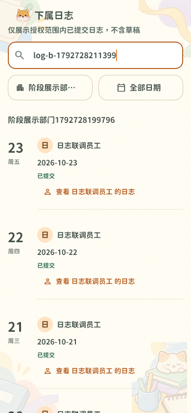

# 成员 B 主线同步与真实联调（2026-10-23）

关联 Issue #22、#24；OpenSpec `member-b-week6-permissions`。

## 主线与范围

- 本地 lyb 从 424206f 快进至 origin/main 5719f2c；PR #26 已由主线合并，没有文本冲突。保留主线 AI 办事工作台及 V1–V19 迁移。
- 用户未提交的 `.idea` 和 AI 指标文件在 `output/main-sync-20261023` 备份并保留；不纳入本批提交。
- 只读检查 good 32ebc78，确认有 C 标签、参与人、任务增删改审核基础。其 V16/V17 与 main 重号，旧库执行状态不明；用户选择本批先完成不依赖 C 的联调，未合入 good、未重编号。

## 修复

1. 下属日志页面不再对服务端匹配结果按姓名/正文二次筛选，避免账号搜索命中后被隐藏；分组优先使用日志响应中的部门。
2. AI 失败收尾/依赖失败收尾与取消统一采用用户→事项→步骤锁顺序，避免写通知的用户外键与取消事务形成死锁。收尾允许对停用用户落失败状态，但不恢复业务执行权限。
3. 两个加密草稿测试使用独立固定数据，避免滚动演示日志与固定日期重叠；等待保存的可观察结果后保留原加密、隔离及错误恢复断言。
4. 真实认证测试在首次改密后断言旧令牌失效，再重新登录；新增真实日志页面联调测试与独立环境脚本。

## 验收证据

- 后端规定命令：`powershell -ExecutionPolicy Bypass -File scripts/test-backend.ps1`，398 项通过，0 失败/错误/跳过，BUILD SUCCESS，退出码 0；包含新增 PostgreSQL 锁顺序测试及原 20 次取消/撤权并发测试。初次 397 项中取消接口曾返回 500；修复前后日志分别为 `output/week6-20261023-backend.log`、`output/week6-20261023-backend-fixed.log`。
- Flutter 全量：`flutter test --no-pub --dart-define=USE_MOCK=true --reporter expanded`，303 通过、0 失败、2 个显式 opt-in 真实联调测试默认跳过，退出码 0。日志 `output/week6-20261023-flutter-final.log`。
- 真实测试另外显式启用，使用 `USE_MOCK=false`、真实 HTTP Repository、Spring Boot 和独立 PostgreSQL/Redis/Neo4j；没有 Mock HTTP Adapter。设备安全存储使用测试内存实现，不作为 Android KeyStore 验收。
- 最终独立脚本退出码 0，两项真实测试各 1 项通过；证据目录 `output/member-b-live-089ab61316`，汇总 `output/week6-20261023-live-real-final.log`。测试容器和进程自动清理，原展示库未改动。
- 最终 `flutter analyze --no-pub` 无问题、退出码 0；`openspec.cmd validate --all --strict` 32 通过、0 失败、退出码 0；`git diff --check` 通过。OpenSpec 12/14 项完成，剩余两项为经用户确认暂缓的 C 接入。
- 认证测试覆盖注册待确认、业务访问拒绝、禁止自审、独立确认、组织候选生效与注销。
- 日志测试创建 31 条不同业务日期的日志，验证账号及部门过滤跨页不丢项、未知部门空结果、员工下属接口拒绝；实际页面填写修订及理由，验证批准前原文不变、禁止自审、独立审核后生效；真实评论回复父子关系；页面撤回后上级不可见，重提保留首次提交时间。
- 真实页面截图输出到本次隔离目录 `output/member-b-live-*/subordinate-logs-live.png`，采用仓库自带中文字体；输出仅包含合成测试账号。


- 两项非功能证据：安全（数据范围/会话失效/禁止自审）；可靠性（并发锁序、审批原子生效、撤回重提时间不重置、跨页完整性）。

## 复现

需要 Docker Desktop、JDK 21、Maven、已初始化的 Flutter SDK 和锁定依赖，以及 `collaboration-data-runtime:local`（按后端部署说明构建）。先执行后端规定回归；然后：

```powershell
powershell -ExecutionPolicy Bypass -File scripts/test-member-b-live.ps1 -FlutterSdk E:/Tools/flutter -SkipBuild
```

FlutterSdk 替换为本机 SDK 路径。`-SkipBuild` 仅在已有当前源码构建的 JAR 时使用；否则去掉该参数。默认 API 端口 18083，被占用时加 `-Port 18085`。该脚本创建随机命名的独立临时数据库，生成随机凭据到忽略的 output 目录，先执行认证测试，再执行日志页面测试，成功或失败均保留日志；默认清理自己创建的进程/临时容器。`-KeepEnvironment` 可保留现场，但不要提交生成的 stage.env 或账号文件。

本机旧 stage-demo 库为另一条历史迁移链，未升级或改写；本次新库验收不能宣称旧展示库已经兼容。不要将旧库直接指向最新 JAR，也不要在原库运行 Flyway repair。

## 剩余边界

- C 接入继续等待迁移发布状态及共同契约：标签公司/部门/个人范围、任务与日志共用标签、创始人维护权限、任务创建/修改/删除审核及 AI 调用兼容均不能报告完成。
- 已验证的是 B 的真实服务页面链路，不等于全项目 Android 真机、全部 AI/OCR 供应商或正式发布验收。浏览器/Android 设备、网络切换和真实 KeyStore 仍由对应发布验收覆盖。
- 不修改已发布迁移，不删除旧业务记录，不改变审批权限以让测试通过。AI 自动正式写入保持默认关闭。
