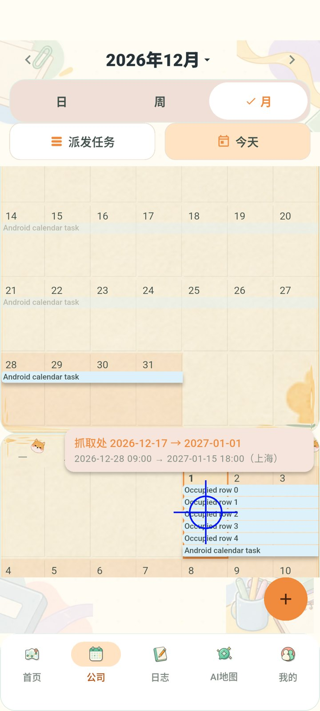
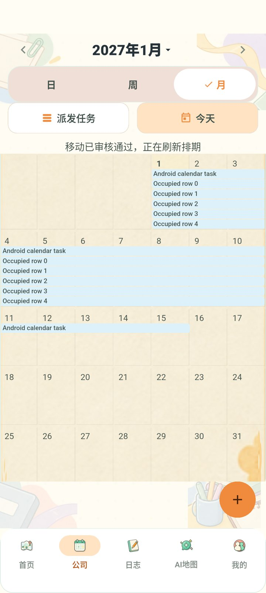

# C-09 补正：正式任务第四行及以后

2026-11-04，Issue #58，PR #67。用户反馈第四行以下仍不可见，周高度没有增加。本报告接续并修正 `verification-lane-layout.md` 中仅覆盖三条已有任务的结论；此前 0.1.4 未解除正式任务容量限制。

## 原因与修复

`_monthLanes` 仍以屏幕初始周高度计算容量并 `clamp(0, 3)`，其余任务被跳过；周高度又只考虑拖动候选。因此正式第四、第五行并不存在于排布中。现在为全部已读取的正式任务动态分配空行，每周按相交正式任务的最高行号与候选行号共同取高度，移除 +N 折叠。跨周行号保持稳定，后续周与月份在原有单一 Sliver 时间线中下移；取消只移除候选，保留正式任务需要的高度。

没有新增接口、迁移、权限或审核规则；待审仍保留正式原日期，审核生效后重新按真实数据排布。修改限于月历布局及其验收脚本，原后端无需更新。回滚可以恢复旧客户端，但会恢复三行限制。

## 验收证据

环境：Windows、Flutter `D:/flutter`、Android API 37 模拟器 `Codex_Calendar58_API37`，本机独立 18089 API 与 Docker PostgreSQL/Redis。没有操作生产业务数据。

- 日历专项命令：PowerShell 展开 `test/calendar*test.dart`（通知测试保持原 HTTP 模式独立范围），`flutter test --no-pub --concurrency=1 --dart-define=USE_MOCK=true ... --reporter expanded`。首轮 **74/76，退出 1**：两个旧断言要求隐藏正式任务／整月强制塞入视口，与当前需求冲突。更新为完整任务展示和滚动到月底的断言后，受影响 `calendar_agenda_test.dart calendar_agenda_visual_test.dart` **15/15，退出 0**，见 `output/calendar-all-rows-layout-final.log`；保留首轮日志 `output/calendar-all-rows-focused.log`。
- 密集与拖动几何：`flutter test --no-pub --concurrency=1 --dart-define=USE_MOCK=true test/calendar_preview_lane_test.dart --reporter expanded`，**7/7，退出 0**；`output/calendar-all-rows-density-final.log`。包含五条正式任务＋第六行候选，650dp/430dp 与 1.0/1.5 字号；额外验证十条正式任务＋第十一行候选。逐条断言不重叠、不越出周格、周高增加且下一周精确下移；取消后正式任务数量和原高度保留，审核列表无写入。各批测试有重叠，不相加宣称总数。
- `flutter analyze --no-pub`：No issues found，退出 0，见 `output/calendar-all-rows-analyze.log`。
- `powershell -ExecutionPolicy Bypass -File scripts/test-calendar-live.ps1 -Device emulator-5556 -Port 18089 -SkipBuild -TaskDays 19 -CrowdedTarget`：**退出 0**。`output/calendar-all-rows-android.log` 与 `output/calendar-live-6103fdf24d/` 保存链路、截图和数据库读回。脚本密集目标由三条改为五条；默认无密集夹具的调用方式不变。
- 非功能：可靠性通过悬停日期稳定、取消无写入及独立审核后版本一致验证；可用性通过小屏大字、五／十条密集任务几何断言及月底可滚动到达验证。

### Android 预览与审核后

19 天任务 `calendar-6103fdf24d-task`，上海时间 2026-12-13 09:00→12-31 18:00；八次拖动取消后，从续段 12-17 拖到 2027-01-01。新排期为 12-28 09:00→01-15 18:00，441 小时保持。目标已有五条 01-01→01-10 的任务，第六行候选可见：

申请 `18256c7e-cde7-4279-824c-d226794ae81c` 独立审批后，任务版本 1→2；两客户端与 PostgreSQL 一致，五条已有任务的日期和版本 1 均保持。界面逐条验证六条正式任务均位于周格内、不重叠，命令表只有一条移动记录。空白日期创建及独立审核也通过。

## 交付与限制

`flutter build apk --release --build-name=0.1.5 --build-number=20261108 --dart-define=USE_MOCK=false --dart-define=API_BASE_URL=http://39.96.84.51/api`：退出 0，见 `output/calendar-all-rows-apk.log`。测试包 0.1.5 / 20261108，连接 `http://39.96.84.51/api`，路径 `output/releases/calendar-all-rows/pandora-calendar-fix-0.1.5.apk`。SHA256 `bfede00490e3cf4df89ddc03197b1b4a250554986501015230db30443ae79a33`。`aapt` 版本与 `apksigner verify --print-certs` 均退出 0，沿用 0.1.4 内部测试签名；构建仍有既有 CupertinoIcons 字体提示。

验收步骤：公司月视图选择同一周已有至少五条任务的范围，检查五条全部展示且该周比空周高；拖入任务应进入第六行、后续周下移；取消保留五条正式任务；提交并独立审核后六条正式任务继续全部显示。查看月底任务时可纵向滚动，不能强制压回固定月高。

本轮未重新运行后端全套、通知专项和 profile 矩阵。历史全仓、性能、真实手机/TalkBack 和非作者审阅缺口保留。PR 尚未合并或部署。

`openspec.cmd validate --all --strict`：47/47，退出 0，见 `output/calendar-all-rows-openspec.log`。提交 `60ba430fac3801747b1c0303cbbc5ccec2fa8c0e` 已推送，PR #67 与 [Issue 验收回执](https://github.com/Ash123-star/Grade3_Work/issues/58#issuecomment-6630392455)已更新。
