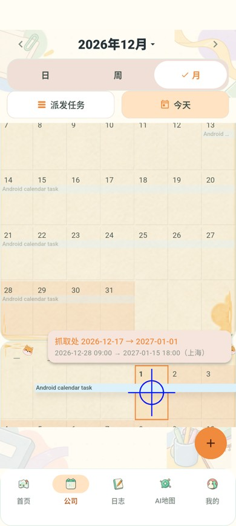

# C-08 长任务落点与月历读取修复验收

日期：2026-11-04。基线 `origin/main`（PR #65 功能及 #66 部署记录之后），分支 `fix/58-calendar-drop-consistency`，关联 [Issue #58 补充需求](https://github.com/Ash123-star/Grade3_Work/issues/58#issuecomment-6626728435)。本修复为客户端变更，尚未合并或部署；原全仓／性能／实机限制继续有效。

## 原因及实现

- 指针移动更新目标早于下一帧绘制；松手又重新命中日期，确认框可能使用用户尚未看到的日期。新增不可变展示快照，在松手时消费，提交前仍重新读取任务并校验版本／权限／排期。长任务继续按实际抓取日整体平移，浮条保持原尺寸；完整候选区间高亮，并在提示和确认框显示抓取日→目标日。
- 通知公共入口与月历监听重复全局刷新，公共刷新内部也有重复失效；月历重建还可能短暂重连通知。现在稳定订阅，公共入口统一去抖刷新，月历监听只取消旧手势并合并待审结果核对。
- 单页读取从 30 提升到服务端已支持的 100，保留快照一致性、两路并发、200 页／5000 条及时间预算。最多保留六个成功月份 30 秒，按会话／成员／月份隔离，显式刷新仍失效。
- 429 尊重 Retry-After，缺省冷却 60 秒；同一 Repository 共享冷却，包括正在分页的其他月份和任务详情失败。重复本地尝试不延长冷却、不继续 HTTP，也不由错误处理再触发全局刷新。完整旧月数据只读展示；权限失败或换账号清除回退数据。恢复由用户主动重试。
- 测试容器随挂载树卸载，确保新缓存定时器在 Flutter 泄漏检查前正确释放。
- 无后端接口、数据库迁移、权限、审核政策、服务端限流阈值或线上配置变更。

## 验证结果

环境：Windows、Flutter `D:/flutter`、Android AVD `Codex_Calendar58_API37` / API 37 / SwiftShader、Java 21、Docker Desktop。真实系统测试使用独立临时 PostgreSQL／Redis 和 18089 端口；后端 JAR 与已部署主干版本一致，SHA256 `9bc921368af1dcb7ebf3e00264d27bc48bc3e5eebc706dfa6eb37b71db7b3c43`。

| 检查 | 结果及本机证据 |
| --- | --- |
| 原问题复现 | 修复前 `calendar_drop_consistency_test.dart` 的帧间释放用例失败，`output/calendar-drop-reproduction.log`；最后一次未绘制移动确实改变确认日期。 |
| 日历专项 | PowerShell 展开 `test/calendar*test.dart`（排除需 HTTP 模式的通知测试），`flutter test --no-pub --concurrency=1 --dart-define=USE_MOCK=true ... --reporter expanded`：69 项通过、退出 0；`output/calendar-consistency-focused.log`。 |
| 最终受影响回归 | 改为稳定通知订阅并增加并发月份 429 用例后，日期一致／读取恢复／拖动／拖动集成／退出五个文件共 23 项通过、退出 0；`output/calendar-consistency-regression-final.log`。此批与上一批重叠，不相加。 |
| 真实通知契约 | `flutter test --no-pub --dart-define=USE_MOCK=false test/calendar_notification_refresh_test.dart test/live_notifications_contract_test.dart --reporter expanded`：12 项通过、退出 0；`output/calendar-consistency-notifications-final.log`。覆盖月历挂载时突发通知只刷新一次、重复序号不读取、分页 100 及停止／重连／账号切换。 |
| 静态分析 | `flutter analyze --no-pub`：No issues found，退出 0；`output/calendar-consistency-analyze-final.log`。 |
| Android 系统链路 | `powershell -ExecutionPolicy Bypass -File scripts/test-calendar-live.ps1 -Device emulator-5556 -Port 18089 -SkipBuild -TaskDays 19`：最终退出 0，`output/calendar-consistency-android-2.log`；证据 `output/calendar-live-069a17a647/`。 |
| Android release | `flutter build apk --release --build-name=0.1.3 --build-number=20261106 --dart-define=USE_MOCK=false --dart-define=API_BASE_URL=http://39.96.84.51/api`：退出 0；`output/calendar-consistency-apk-final.log`。`aapt` 版本核验及 `apksigner verify` 均通过。 |
| OpenSpec | `openspec.cmd validate --all --strict`：47/47，退出 0；`output/calendar-consistency-openspec.log`。 |

### Android 与数据证据

19 天任务 `calendar-069a17a647-task` 原上海时间 2026-12-13 09:00 至 12-31 18:00，时长 441 小时。从跨周续段抓起，先完成八次拖动→确认日期断言→取消，无申请、无冷却提示；随后将抓取日 12-17 拖到 2027-01-01，候选完整区间为 12-28 09:00 至 01-15 18:00。确认框精确匹配候选描述；无原因提交被拒绝且无待发命令。

填写原因后申请 `ddfcef1d-8083-4d6f-b9d5-ec1a92f12301` 待审，数据库保持版本 1／原日期；独立账号审核通过后版本 2，两个客户端和 PostgreSQL 均读回候选日期，时长仍为 441 小时，改期命令表恰有一条记录。空白长按的日期预填、任务创建及独立审批也通过。

截图仅缩小尺寸，数据为隔离测试夹具。首次系统测试完成八次取消后，截图准备将指针移动到半露出单元格的中心，中心超出视口导致预览无效；修正测试为等待跨月日期完整进入安全区域再截图，第二轮完成上述链路。首次数据库没有改期或命令记录。

### 非功能验收

- 可靠性／请求预算：帧间松手使用已展示日期，取消／无效落点不写；十次冷却尝试只产生首次请求；另一个月份触发 429 会阻断已在途月份的后续分页；冷却结束可重新加载。真实通知突发每个仍挂载月份只读取一次，重复序号不新增读取。
- 安全／资源生命周期：月份缓存有数量及时间上限，换会话和显式失效重新读取；新账号 429 不显示旧账号任务，403 清除只读回退；退出、权限变化和源月份回收既有回归通过，卸载无残留定时器。

## 限制与发布

本批只验收受影响模块及真实 Android 系统链路，没有重新执行全仓后端／Flutter 套件或完整性能矩阵。此前全仓测试失败、SwiftShader 慢帧、真实手机／TalkBack 和非作者审阅未完成仍见 [主干整合验收](verification-integration.md)，不能由本批通过推断已解决。

测试 APK：`output/releases/calendar-drop-consistency/pandora-calendar-fix-0.1.3.apk`，版本 0.1.3 / 20261106，真实 API `http://39.96.84.51/api`，SHA256 `6e912060e8efc5e22383415818940028287e36adde030867ac3b4db830b1f2a8`。沿用内部测试签名（证书 SHA256 `01f96b607c465b59396b3431f01ff61b082e15fc5fbfcbae9e7e921217090b9e`），无系统测试令牌，不是商店发布包。首次 `--no-pub` 打包受 integration_test 生成注册文件残留影响失败；正常依赖生成后重建通过，未手改生成文件。构建仍有既有 CupertinoIcons 字体提示。

客户端版本可与当前线上后端兼容；无需数据库迁移或后端重启。本轮未操作云端服务或生产任务。回滚为恢复上一版客户端（Android 降级需按安装策略处理），现有审核申请仍由已部署服务端处理。

手工验收：安装 APK，使用有资格账号进入公司→月视图；从长任务中间日或跨周续段长按，移动到另一日期，核对抓取日映射、整段高亮和确认框的新起止日期；取消后确认没有申请。重复八次，再提交一条并按既有审核政策处理。限流状态使用隔离测试环境注入 429 验证倒计时／只读／恢复，不通过刷生产接口制造限流。
