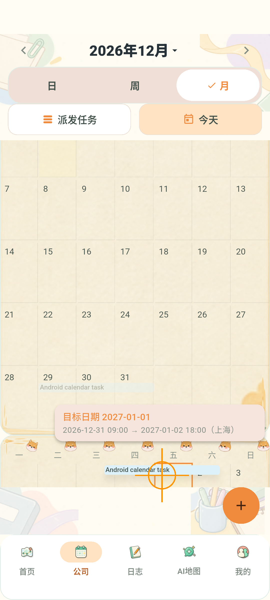
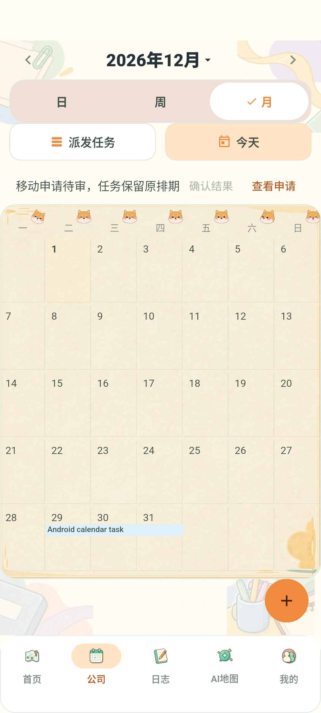
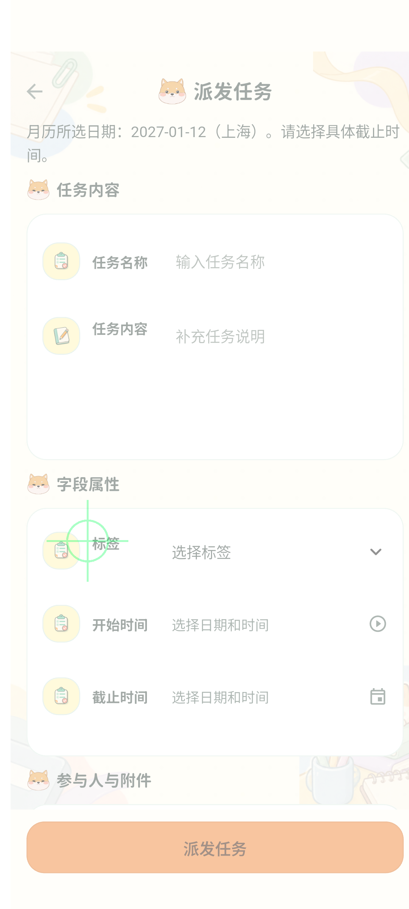

# 当前主干整合验收（2026-11-04）

关联 Issue #58。本报告针对 `feature/58-calendar-drag-integration`，基线为已发布 `main` 的 `c058214a6c3db79f4b14b4ae763c4dd04b75fd78`。`verification.md`、旧截图和旧 PR #59 的历史结果不能替代本批验收。以下为实现阶段记录；后续用户明确要求发布，PR #65 已合并，云服务器已升级并开启能力，详见 [部署记录](deployment-20261104.md)。

实现提交 `4674f5e` 最初交付为[草稿 PR #65](https://github.com/Ash123-star/Grade3_Work/pull/65)，后按用户明确指令合并为 `70f85af` 并部署；[实现阶段 Issue 进展](https://github.com/Ash123-star/Grade3_Work/issues/58#issuecomment-6625043331)保留。合并和部署不代表已满足所有验收条件。

## 原因与实现

- 已发布主干任务条原先处于 `IgnorePointer` 下，没有长按拖动入口；旧 PR #59 尚未合并，且其 V22 迁移与当前主干冲突。
- 整合为 V27 新迁移，保留已发布迁移、首页任务看板、个人事项、参与人过滤、`ownerId` 兼容别名、审核 `expectedVersion` 和当前直属审核／创始人免审规则。
- 长按约 500ms 后一次触觉反馈，复制原尺寸条带并上浮，原条淡化；按抓取日期计算整段位移，保持起止时刻和时长。命中目标日期与新起止时间分开提示。
- 手势状态、几何与日期领域运算、浮层表现、确认对话框、提交重试和持久化分别隔离。长按识别后由月历表面接管指针，源月份控件被回收仍可跨月拖动。
- 高频指针更新仅刷新浮层；日期高亮只在目标变化时更新。修复浮层首次布局前重复插入、取消对话框控制器过早释放、不可拖动任务条误触空白创建、跨月空白补位格重复高亮。
- 待审时正式日期保持原位；失败／取消不回写旧快照。版本冲突、权限变化和返回结果不确定分别处理；同键重放、账号公司隔离和退出清理保留。

## 已执行检查

环境：Windows、Flutter `D:/flutter`、Java 21、Maven 3.9.9、Docker Desktop 4.78.0 / Engine 29.5.3；Android AVD `Codex_Calendar58_API37`，`emulator-5556`，SwiftShader。数据库为独立临时 Docker 实例，未使用旧分支 V22 数据库。

| 检查 | 结果与证据 |
| --- | --- |
| 日历专项 | `flutter test --no-pub --concurrency=1 --dart-define=USE_MOCK=true test/calendar*test.dart`（PowerShell 先展开文件列表）；最终 59 项全部通过，退出 0。日志 `output/calendar-focused-final2.log`。 |
| Flutter 分析 | `flutter analyze --no-pub`，最终退出 0、No issues；`output/calendar-analyze-final4.log`。 |
| 后端日期／查询单测 | `mvn.cmd -B -f server/pom.xml -Dtest=TaskScheduleTest,TaskQueryServiceTest test`，14 项通过，退出 0；`output/calendar-backend-unit-final.log`。 |
| 受影响后端专项 | 复用 `scripts/test-backend.ps1` 的临时数据库启动及清理流程，原生 Maven 选择 `CalendarMigrationUpgradeTest,Task*Test,PersonalTodoIntegrationTest,Todo*Test`：108 项，107 通过、1 失败，退出 1；`output/calendar-backend-focused-final.log`。 |
| 专项中的核心链路 | `TaskDispatchIntegrationTest` 40/40；空库及 V26→V27 的 `CalendarMigrationUpgradeTest` 1/1；个人事项 HTTP 7/7、个人事项领域 4/4、个人事项迁移 1/1。含改期／旧模式兼容、版本／幂等冲突、越权、独立审核、创始人免审、快照和范围边界。 |
| Android 系统链路 | `powershell -ExecutionPolicy Bypass -File scripts/test-calendar-live.ps1 -Device emulator-5556 -Port 18089 -SkipBuild`：最终退出 0、真实 UI→HTTP→PostgreSQL 通过；最终证据目录 `output/calendar-live-8a434d57ed/`，含截图、results.json、database-after.txt。首轮环境保留用于 profile，之后已清理；最终轮自动清理。 |
| profile | `flutter drive --profile --driver=test_driver/calendar_live_driver.dart --target=integration_test/calendar_drag_profile_test.dart -d emulator-5556 --dart-define-from-file=<临时隔离夹具>`，退出 0、10 次跨月手势全部成功且不写任务；236 帧全部超过 16.7ms，2 帧超过 100ms，最长 209.951ms。**性能目标未达到**；`output/calendar-profile-integration/results.json`。 |
| Android release | `flutter build apk --release --dart-define=USE_MOCK=false --dart-define=API_BASE_URL=http://39.96.84.51/api`，最终退出 0；`output/calendar-apk-final2.log`。产物 `output/releases/calendar-drag-integration/pandora-calendar-drag.apk`，不包含测试令牌；沿用项目内部调试签名，非商店发布包。 |
| OpenSpec | `openspec.cmd validate --all --strict`，47/47，通过、退出 0；`output/calendar-openspec-final.log`。 |

### 真实数据证据

第一次当前基线系统验收：任务 `calendar-a638bb6db6-task` 原版本 1，上海时间 2026-12-29 09:00 至 2026-12-31 18:00；拖动后审核申请 `d0bc9e95-36b9-4086-adff-82fdb93ddec4` 待审时数据库不变。独立审核通过后版本 2，起止为 2026-12-31 09:00 至 2027-01-02 18:00，均平移两天，时长保持 57 小时。第二 HTTP 客户端读回一致。幂等命令表只有一条关联记录。

空白日期创建通过现有人员和真实标签目录选择、日期／时间确认、独立审核；创建审核 `21f5dfd2-837a-4375-b721-52a28fc03d78` 生效为任务 `8d2e70b8-31be-433c-bdfb-75c1f42e97d3`。空原因提交被 UI 拒绝，尚未持久化或发送改期命令。

## 非功能与未通过项

- 安全：HTTP 权限、跨公司访问、审核自审限制及会话隔离有专项测试；普通日志和提交文件不含测试令牌。服务端能力关闭时客户端不能自行开启拖动。
- 可靠性：同键响应丢失、重复确认、同版本不同键竞争、版本冲突、存储失败、多指／后台／取消、跨月源控件回收有专项证据；正式数据由服务器刷新，不用原快照覆盖并发修改。
- 易用性：360/390/412dp × 1.0/1.5 字号的 Widget 检查通过，模拟器真实截图已检查。真实手机触觉强度、TalkBack 和完整手工矩阵尚未验收。
- 性能：已将逐帧整页重建拆为浮层和目标日期通知，但本次 SwiftShader 测量仍未达到设计门槛，不能宣称达到苹果日历的设备流畅度；需目标 60Hz 实机 profile 复验及必要优化。
- 后端专项唯一失败：`TaskComponentsTest.timelineOrderedBySequence` 仍期待 `ORDER BY sequence`，现有查询为 `ORDER BY e.sequence`。该测试及 `TaskTimeline.java` 均与当前 `HEAD` 完全一致，本批未修改。不能将专项总体写成通过。
- 全仓 Flutter 默认并发曾因内存失败；改为单并发后累计 323 通过、3 跳过、18 失败，并在现有 `task_label_selector_test.dart` 长时间停住，已终止（进程退出 1）。成员页面测试在独立干净主干副本也复现 4 项失败；其余全仓失败未逐一完成基线归因。日志 `output/calendar-flutter-full-serial2.log` 和 `output/calendar-main-baseline/mobile/baseline-test.log`。
- 全仓后端统一命令已尝试，Docker 控制面／数据库连接中断，未取得成功退出码。经用户授权重启后恢复；仅重跑了受影响专项，不能替代全仓通过。
- Docker 修复保留了两个失效运行目录的备份，再生成运行目录；未删除其他项目的数据库或容器。临时测试 API／数据库和含令牌的 defines 文件在验证后清理。

## 验收与发布条件

1. 有改期资格用户在公司月视图长按任务条约 500ms：一次震动，原尺寸浮起；拖到其他周／月显示落点及新起止，任务时长保持。
2. 在边缘停留进入相邻月；松手确认，空原因拒绝，取消不产生申请。无权限任务条长按不创建任务。
3. 提交后按当前审核规则处理；需要审核的任务留在原日期，独立审批后所有入口读取新版本。失权、冲突、超时分别提示，超时只允许原键确认。
4. 长按空白日期进入现有派发表单，只预填所选日期；时间、人员和标签仍由用户明确选择。短按、普通滚动和多指取消不得误提交。
5. 保持代码中的 `CALENDAR_MOVE_ENABLED=false` 默认值；所有审核消费者兼容 V27／MOVE 后才能按发布流程启用。后续部署已按该顺序在云服务器开启，实际测试应使用部署记录中的 0.1.2 APK。

全仓检查、性能、实机／TalkBack 和非作者审阅缺口继续保留，不能宣称全部验收完成。此次合并上线依据用户后续明确指令执行，不代表常规门槛已通过；迁移／回滚见 `docs/calendar-task-drag-release.md` 和部署记录。

最终系统链路的任务／审核 ID、两轮测试计数和 profile 指标见 [机器可读证据](verification-integration-evidence.json)。最新截图中的橙色指针标记来自测试触点显示：

APK SHA256：`2A972561801DC0CEAF0990B8EB424B0C1157444C8F0A49B22F56393C96D872BA`。

