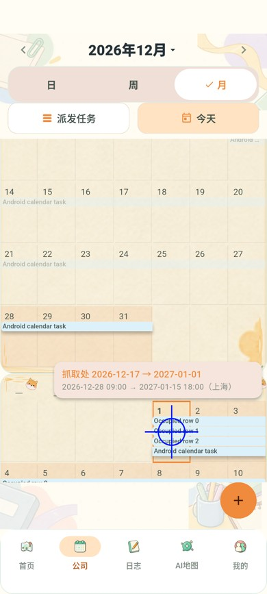

# C-09 拖动避让与周高度验收

2026-11-04，Issue #58，接续 [PR #67](https://github.com/Ash123-star/Grade3_Work/pull/67)，分支 `fix/58-calendar-drop-consistency`。用户明确确认“向下撑高这一周”。修复尚未合并或部署。

## 实现与边界

原正式任务有排布逻辑，但拖动副本在浮层跟随指针，不参与占位，因而覆盖目标条带。现在由 `calendar_preview_lane.dart` 按含端点的完整日期区间选择空行，排除源任务自身；既有条带保持行号。候选跨周、跨月剪裁到真实日期格，浮层仅显示抓取日映射及排期。

每个受影响周只增加所需高度，后续周整体下移；`calendar_month_timeline.dart` 用双向懒构建 Sliver 承载可变高度月份，只有一套纵向滚动，保留外部选月、反向滚动和边缘自动滚动。布局变化后补偿目标日顶部位移，暂停中间状态命中，避免手指不动而改日。取消、无效落点、会话／布局变化清除候选，恢复正式排布。

新增排布没有 Repository／提交依赖；原正式列表的更多任务入口、权限、版本、抓取日锚点、时长和审核规则保持。待审时仍显示正式原日期。本轮没有后端／接口／数据库／线上配置变更。

## 运行结果

环境：Windows，Flutter `D:/flutter`，Android AVD `Codex_Calendar58_API37`／API 37／SwiftShader，Java 21，独立 Docker PostgreSQL／Redis 与本机 18089 API。后端使用已发布主干 JAR，未操作生产任务。

| 检查 | 证据 |
| --- | --- |
| 日历专项 | PowerShell 展开 `test/calendar*test.dart`，排除单独 HTTP 模式运行的通知测试，执行 `flutter test --no-pub --concurrency=1 --dart-define=USE_MOCK=true ... --reporter expanded`：**76/76，退出 0**；`output/calendar-lanes-focused-final.log`。 |
| 通知契约 | `flutter test --no-pub --dart-define=USE_MOCK=false test/calendar_notification_refresh_test.dart test/live_notifications_contract_test.dart --reporter expanded`：**12/12，退出 0**；`output/calendar-lanes-notifications.log`。 |
| 静态分析 | `flutter analyze --no-pub`：No issues found，退出 0；`output/calendar-lanes-analyze-final.log`。 |
| Android→HTTP→数据库 | `powershell -ExecutionPolicy Bypass -File scripts/test-calendar-live.ps1 -Device emulator-5556 -Port 18089 -SkipBuild -TaskDays 19 -CrowdedTarget`：**退出 0**；`output/calendar-lanes-android.log`，细证据 `output/calendar-live-7131ef6fd1/`。 |
| 月视图重新进入回归 | 最后补充 `keepScrollOffset: false`，避免周／日视图切回月视图时重复应用月份偏移；`flutter test --no-pub --dart-define=USE_MOCK=true test/calendar_preview_lane_test.dart --reporter expanded`：**6/6，退出 0**（与上述专项重叠）；`output/calendar-lanes-navigation-final.log`。 |
| APK | `flutter build apk --release --build-name=0.1.4 --build-number=20261107 --dart-define=USE_MOCK=false --dart-define=API_BASE_URL=http://39.96.84.51/api`：退出 0；`output/calendar-lanes-apk-final.log`。含最终重新进入修复；`aapt` 版本与 `apksigner verify` 均通过。 |
| 规范 | `openspec.cmd validate --all --strict`：47/47，退出 0；`output/calendar-lanes-openspec.log`。 |

首轮专项 74/75，唯一失败是重用条带绘制时文字容器丢失满宽约束；修复并完成受影响 27 项及上述最终 76 项通过。新增用例最初用日期格中心做 hitTestable 查找，密集任务正好占据中心，改为读取日期格的真实矩形后通过，没有放宽不相交断言。

### 可靠性与可用性

- 六个新增用例验证：含端点／尾部重叠，连续占用多行，不重叠区间复用空行，忽略源任务；650dp／430dp 月历、1.0／1.5 字号的候选与所有可见正式条带矩形不相交。
- 密集周所需高度增加，后一周下移距离精确等于增高量；候选底边处于日期格内部。前一周展开时的月底悬停保持原业务日期，确认框保持整段新日期；取消无审核记录并恢复周高度。
- 外部跳到十二月后反向滚到十一月，滚动位置不被选月回调重置；跨月源控件回收、月底空白格、辅助入口、退出和 C-08 日期／冷却回归均通过。

### Android 实际数据

19 天任务 `calendar-7131ef6fd1-task`，原上海时间 2026-12-13 09:00→12-31 18:00，441 小时。完成八次拖动取消后，从续段抓取日 12-17 拖到 2027-01-01；目标已有三条 01-01→01-10 的任务，候选位于第四行，与其他条带矩形不相交。

预览／确认框对应 12-28 09:00→01-15 18:00。申请 `fd7103dd-ad4e-4cbb-ab60-dfaf12465b8f` 经独立账号审核后，版本从 1 到 2、时长保持 441 小时，两客户端与 PostgreSQL 读回一致；三条已有任务仍为版本 1、原日期，命令表仅有一条移动记录。空白日期快捷创建及其独立审核也通过。

## 测试包与限制

`output/releases/calendar-lane-layout/pandora-calendar-fix-0.1.4.apk`，0.1.4 / 20261107，API `http://39.96.84.51/api`。SHA256：`225d31f32250cf86cadf86755d6560268887d230b1dc036959451fa247c4bd59`。沿用内部测试签名，与 0.1.3 证书一致；未嵌入系统测试令牌。构建仍有既有 CupertinoIcons 字体提示。

验收：选择有资格账号，在公司月视图从中间日／跨周续段拖到已有任务的日期，检查另占空行，拥挤时该周向下展开、后续周下移；悬停后松手核对确认日期，取消检查恢复；按既有审核规则验证生效。0.1.4 包可直接连接现有后端，无需服务端更新。

本轮未重新跑完整后端套件或 profile 性能矩阵。此前全仓失败、模拟器慢帧、真实手机／TalkBack 和非作者审阅缺口仍保留；不能以此次专项通过视为全部产品验收完成。需回滚时恢复上一版客户端，现有审核申请保持由当前服务端处理。
