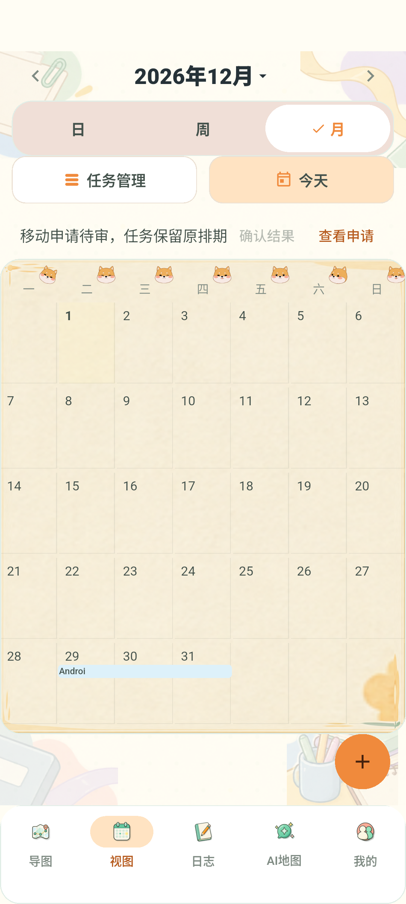
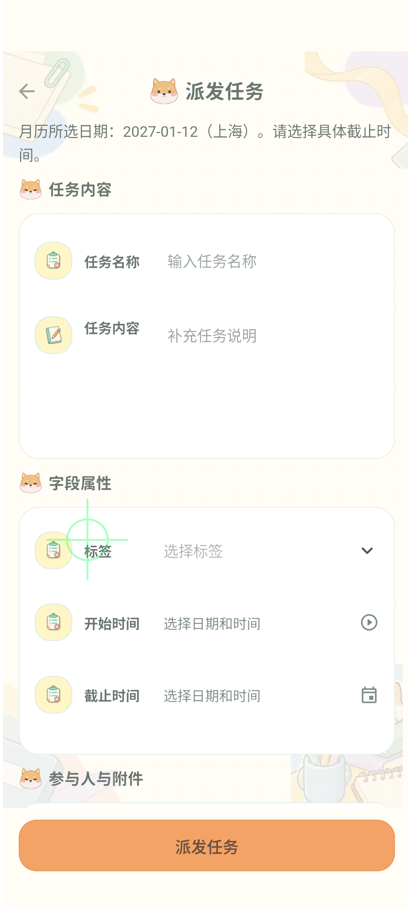

# 日历任务拖拽实施与验证记录

记录日期：2026-11-03（Asia/Shanghai）。Issue [#58](https://github.com/Ash123-star/Grade3_Work/issues/58)，分支 feature/58-calendar-task-drag，基线 19db6f3。原目录 D:/1/Practice_Grade_3/Program 的用户改动未覆盖。

## 当前结论

月历整段拖动、跨月边缘滚动、原因确认、待审原位、独立审核生效及空白带日创建已取得真实 Android → HTTP → Docker PostgreSQL 链路证据。主体实现和本功能专项验证已完成；全仓测试仍有失败，模拟器性能目标未达到，完整设备人工矩阵、TalkBack、B/D/E 人工确认及非作者审阅尚未完成。尚不满足整体交付、合并、上线或归档门槛。用户于 2026-11-03 明确授权直接推送 PR 并以中文评论列举工作，本轮按该授权提前提交并发布草稿 PR，保留全部未通过项。新模式默认关闭，仅隔离验收实例开启。

## 实现与范围审阅

C 实现真实日期锚点、纯预览 Overlay、单一滚动 ticker、MOVE 候选、版本与公司权限校验、安全命令存储、有限同键确认及创建日期路由。task from/to 查询采用区间相交、快照令牌与完整分页预算。V22 只新增命令表及相关索引；旧截止时间候选兼容。日期移动只更新 start_at/deadline、正文对应时间、版本及必要事件/审计/outbox，不修改人员、标签、附件或生命周期。

集中验收修复了：周行宽度为零导致任务不可见；穿过已加载月份空白格/星期标题时边缘滚动停滞；跨月任务条画进无日期目标的相邻月空白格而无法拿起。最后一项已限定每页任务续段在本月实际日期内，并对 2026-12-31/2027-01-01 分别执行真实长按回归。性能检查后还将月历外层重建限制在拖动开始/结束，落点和 Overlay 独立逐帧更新；相同 26 项回归及 10 次手势复测通过。密集日期的最小 +N 接入用于保护任务条与创建空白命中，没有接管 D 的完整布局/节假日业务。

真实独立审批还发现 HttpRepository 发送了审核接口不接受的 expectedVersion；已按既有 approve/reason 契约修正并补 HTTP 回归。退出登录时本地改期记录清理失败现在仍完成退出并明确提示，异步清理按会话 epoch 隔离。基线 detail_pages.dart 缺失闭括号、重复局部声明及 dashboard 无效非空断言只做必要编译修复；无关整文件格式化已清理。

## 集中验收证据

以下批次有交叠，测试数不能相加为去重总数。原始日志保存在本机 ignored output/；Windows PowerShell 重定向的日志为 UTF-16LE，使用 Get-Content 读取；不提交访问令牌、测试凭据、数据库密码或 APK。可审阅摘要见 [verification-evidence.json](verification-evidence.json)。

| 范围 | 命令/环境与日志 | 明确结果 |
| --- | --- | --- |
| 后端 task 与迁移 | Docker Maven 3.9.9 / Temurin21，mvn -B -f server/pom.xml -Dtest=CalendarMigrationUpgradeTest,Task*Test test；calendar-docker-task-final.log | 退出 0，85 项通过 |
| 日历 HTTP、并发与故障 | Docker Maven，TaskDispatchIntegrationTest#calendar*；calendar-docker-recovery-final.log | 当时 10 项，退出 0；后续增强场景另列下两行 |
| 跨年与快照边界 | TaskDispatchIntegrationTest#calendarReplayKeepsArchivedConstraintsAcrossNewYear+calendarRangeUsesIntersectionSnapshotAndTerminalCursor+calendarRejectsMalformedModesTypesPermissionsAndConstraintChanges；calendar-docker-boundaries-final.log | 退出 0，3 项；包含候选落在跨年后新窗口外仍按存档审批、总数不变的替换/重排拒绝旧令牌、待确认/失派发资格 403、停用会话 401 |
| 无审核人及驳回 | TaskDispatchIntegrationTest#calendarNoReviewerStaysPendingAndRejectionKeepsOriginalSchedule；calendar-docker-rejection-final.log | 退出 0，1 项；无审核人待审且零步骤、自审拒绝、空驳回原因拒绝、驳回原值不变、原键返回同一 REJECTED 申请、新键可重新申请 |
| V22 空库/存量升级 | CalendarMigrationUpgradeTest，Docker PostgreSQL16；calendar-migration-final.log | 退出 0；空库、V21 升级、存量保留、重复迁移、键 128/129 字符、唯一约束与跨公司 FK |
| Flutter 核心聚合 | flutter test --no-pub --dart-define=USE_MOCK=true，日历专项；calendar-flutter-final.log | 退出 0，45 项；含日期、持久化失败、响应丢失、重试预算、A→B→A、分页与共享并发预算 |
| 最终月末/布局/辅助操作回归 | flutter test --no-pub --dart-define=USE_MOCK=true test/calendar_drag_widget_test.dart test/calendar_agenda_test.dart test/calendar_agenda_visual_test.dart test/calendar_accessibility_test.dart；calendar-month-boundary-ui.log | 退出 0，26 项；含最终跨年条带修复 |
| 登出异常与会话切换 | test/calendar_logout_widget_test.dart；calendar-logout-final.log | 退出 0，2 项；清理失败不阻止退出，旧清理不覆盖新账号 |
| 无障碍自动化矩阵 | test/calendar_accessibility_test.dart；calendar-accessibility-final.log | 退出 0，6 项；360/390/412dp × 1.0/1.5 字号、减少动画、语义 customAction 与普通替代按钮、至少 48dp、取消零写入。不能替代真实 TalkBack 人工验收 |
| Flutter 最终分析 | flutter analyze --no-pub；calendar-analyze-final.log | 退出 0，No issues found；包含新增 integration/profile 文件及无关格式化清理 |
| Android 真实链路 | scripts/test-calendar-live.ps1 -ApiContainer workpanel-calendar58-api -DataContainer workpanel-calendar-live-f8fed0074f -Device emulator-5556 -Port 18088 -KeepEnvironment | 退出 0，CALENDAR_ANDROID_LIVE_PASSED；目录 output/calendar-live-373c2d9d87 |
| API 重启后原键确认 | Docker restart workpanel-calendar58-api，重启前后提交同一原命令；calendar-restart-replay.json | 均 200，同一 APPROVED 审核 ID，命令 1 条、RESCHEDULED 事件 1 条 |
| 10 次真实跨月拖动 | flutter drive --profile --no-pub --driver=test_driver/calendar_live_driver.dart --target=integration_test/calendar_drag_profile_test.dart -d emulator-5556 --dart-define-from-file=../output/calendar-live-373c2d9d87/test-defines.json | 退出 0，手势与测量成功，版本不变；性能阈值未通过，详见下文 |
| HTTP release APK | flutter build apk --release --dart-define=USE_MOCK=false --dart-define=API_BASE_URL=http://10.0.2.2:18088/api；calendar-release-final.log | 退出 0；117.2MiB（122909455 bytes），lib/main.dart，不含测试 token defines |
| OpenSpec 最终 strict | openspec.cmd validate --all --strict；calendar-openspec-final.log | 退出 0，41 passed / 0 failed |

## Android 业务与数据证据

设备是独立 AVD Codex_Calendar58_API37，API37、emulator-5556、SwiftShader。生产 PandoraApp、HttpRepository、实际安全存储连接 Docker API/PostgreSQL；没有用 Mock 替代服务端。测试使用专门合成公司与独立审核账号。

1. 长按任务并经边缘滚动进入下一月；松手后空原因校验拒绝，尚未保存命令或写业务。填写原因后提交，安全存储读回原键；待审时版本仍为 1、正式日期仍为原值。
2. 独立 reviewer 通过申请，原客户端详情、月份 provider、另一 HTTP 客户端读到版本 2。开始从上海 2026-12-29 09:00 移到 2026-12-31 09:00，截止从 2026-12-31 18:00 移到 2027-01-02 18:00；时刻和时长保持。
3. 空白长按打开真实 FormPage 并预填所选日。用户明确确认日期、时刻、必选标签及参与人；待审创建不出现在正式列表，独立审批后任务出现。数据库 deadline 为 2027-01-11 16:00 UTC，即所选上海 2027-01-12 00:00；start_at 仍为空。
4. 改期审核 ID 为 73c6827a-1754-410d-bd6d-446a37e15b8c；创建审核 ID 为 91a9d205-aa55-4f3a-a646-5ae1f3059757。原始前后值、任务 ID 和去重计数保存在摘要 JSON 与本机 database-after.txt。

这两张截图来自上述成功系统链路；最后的月末条带裁剪另由随后 26 项回归及 10 次 profile 手势验证，截图不作为最终布局所有边界的替代证据。

## 性能与尚未完成的设备验收

profile 模式可在本模拟器运行，不能再记为“不支持”。10 次通过生产长按识别器拿起和边缘跨月，每次取消且核对服务端版本不变。初次采样 211 帧，慢帧 100%，最长 47649μs。减少外层重建后最终采样 233 帧，以 FrameTiming.totalSpan > 16667μs 计慢帧：233 帧（100%），>100ms 为 0 帧，最长 57938μs。没有量化证据说明慢帧得到改善；两轮原始指标均保存在摘要 JSON。设计要求慢帧比例 ≤5%；本次未达标。脚本退出 0 表示手势和测量成功，performanceTargetMet=false 明确表示性能验收失败。不能将软件渲染模拟器结果推广为目标真机达标，也不放宽规格阈值。

真实 TalkBack 操作、360/390/412dp 完整人工任务密集/续段/慢网/断网/后台矩阵尚未完成。已通过 Widget 语义和字号矩阵、后台/多指/会话/尺寸/并发版本取消，以及注入丢响应/超限 Retry-After/本地存储失败的自动化证据；这些不能替代完整设备人工验收。3.8、5.6 因而保留未勾选。

## 全仓失败、共享契约与交付限制

- 完整后端 scripts/test-backend.ps1 -KeepContainers 已执行，退出 1，421 tests / 91 failures / 7 errors。失败集中 AI、日志及历史契约；没有逐项基线对比，不能断言全属既有问题。
- Flutter 完整 USE_MOCK=true 批次退出 1，284 passed / 3 skipped / 39 failed。日历专项后续通过不能改写这个全仓结果。
- member_workspace_contract_test.dart 的任务日历契约通过，另外三个联系卡/日志用例失败，未扩大修改其他业务。5.5 的全仓交付门槛仍未满足。
- 创建页目前使用四个固定标签 ID。脚本只选择一个未占用 ID，在合成公司插入合法同公司标签，不覆盖已存在标签；同一 disposable 数据库最多供四个此类独立夹具使用，用完须新建隔离数据库。该限制源自共享表单契约，未为测试通过而改造 B 的标签业务。
- B/D/E 的人工确认、线上审核消费者兼容状态及非作者审阅未取得。代码接入契约见 implementation.md；1.2、6.4 保留未勾选。
- HTTP release APK：mobile/build/app/outputs/flutter-apk/app-release.apk，SHA256 338590B39EF4412C8A2FDC0CEC65CB8F78DAB332CEB1DB2DC8FEF1B451888F83。首次 --no-pub 构建因 drive 留下的集成插件注册元数据失败（calendar-release-stale-registry.log），去掉 --no-pub 让 Flutter 刷新插件注册后成功；未修改生成 Java 文件或生产依赖。
- HTTP release 模式 APK 仅供模拟器内部联调，地址为 10.0.2.2:18088；仓库仍采用既有 debug signingConfig，不是商店发布包。构建入口为 lib/main.dart，未传测试 token defines；已扫描 APK 内三个 ABI 的 libapp.so，未发现该合成夹具的两个 token 或 taskId，检查退出 0。
- 按用户明确授权，已推送 feature/58-calendar-task-drag 并创建[草稿 PR #59](https://github.com/Ash123-star/Grade3_Work/pull/59)，另发布[中文工作清单评论](https://github.com/Ash123-star/Grade3_Work/pull/59#issuecomment-6596996618)。后端 de12afe、移动端 0148d8c、提案/证据 760907c 三笔提交均已得到远程回执；本记录随后的状态提交用于同步交付事实。全仓失败、性能及人工门槛继续阻止合并/上线/归档；后续修复后只重跑受影响检查。

## 非功能结果与复现

安全：真实 HTTP 拒绝跨公司、越权、待确认、停用和调岗失权；本地公司/账号隔离、旧会话晚到不回写。可靠性：同键并发同申请、同键异摘要冲突、两键争抢同版本、旧 pending 不占新版本、事务回滚、审批最多一次生效、响应丢失和 Docker API 重启后原键确认均有运行证据。可用性：真实拖动/创建、日期一致性、辅助替代操作矩阵已通过；设备 TalkBack 和性能仍有验收缺口。

复现服务端可运行 scripts/test-backend.ps1 -DockerMaven；它会运行全仓，并应保留真实失败结果。日历专项用 Docker Maven 的上述 -Dtest 选择器。系统链路执行 scripts/test-calendar-live.ps1，新建夹具，避免对已创建过同名任务的成功夹具反复执行创建断言。profile 可复用一次成功夹具的 ignored test-defines.json，切换 release/测试模式时允许 Flutter 的 pub 元数据阶段刷新原生插件注册（不要始终使用 --no-pub）。最终一次 driver 测量日志有未注册 native integration_test 的提示：该次使用 Dart Flutter driver 获取 JSON，明确退出 0；未声称 Android instrumentation 结果通过。后续 live 脚本已移除 --no-pub 以避免依赖上一构建的插件注册；该文件含临时凭据，不得提交或打入正式 APK。

发布分支基于 origin/codex/ai-work-assistant 的 19db6f3（未合并 PR #38），本次 PR 以该分支为 base，避免混入管理后台/部署的三个基线提交。2026-11-03 fetch 后主干已为 05d6c25，且已存在 V22__mobile_p0_contracts_and_direct_review.sql、V23__ai_confirmation_receipts.sql；本功能迁移在当前基线为 V22，未来集成主干前必须协调新迁移编号、审核/列表/表单契约并重新验证，不能直接合并主干或改写已发布迁移。

本任务 Docker API 为 http://127.0.0.1:18088/api；状态和启停说明见 output/calendar-docker-runtime.md。用户既有 8080 服务和其他容器未修改；旧本机辅助数据库/API 进程已停止。发布顺序、开关与 V22 回滚见 docs/calendar-task-drag-release.md。
